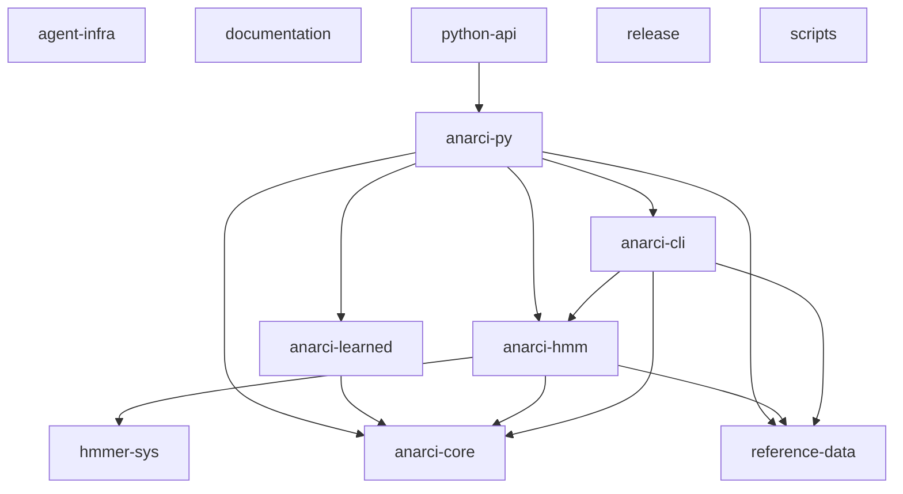
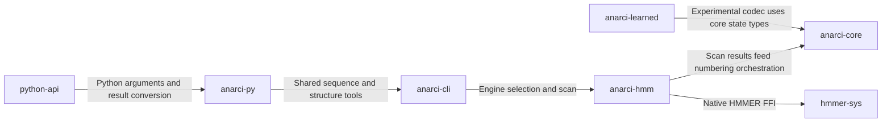

# Repository architecture

Generated by `python3 scripts/agent_tools.py generate`. Do not edit this file.

## Declared dependencies

Arrows point from consumer to dependency. Local Cargo dependency kinds, optional features and reviewed data dependencies are included.

## Annotation flow

Reviewed entry-point relationships; these arrows are not a complete execution trace.

## Components

| Component | Source | Purpose | Validation recipes |
|---|---|---|---|
| agent-infra | [.agents](../../.agents) | Agent routing policy, repository graph generator and instructions | agent |
| anarci-cli | [crates/anarci-cli](../../crates/anarci-cli) | anarci-cli | cli |
| anarci-core | [crates/anarci-core](../../crates/anarci-core) | Pure-Rust core of anarci-rs: state vectors, numbering schemes, germline assignment | core |
| anarci-hmm | [crates/anarci-hmm](../../crates/anarci-hmm) | Safe in-process HMMER 3.4 scan engine producing ANARCI-compatible HSPs. | hmm |
| anarci-learned | [crates/anarci-learned](../../crates/anarci-learned) | anarci-learned | learned |
| anarci-py | [crates/anarci-py](../../crates/anarci-py) | PyO3 module `anarci_rs`: drop-in Python API for ANARCI, all-Rust internals. | python |
| documentation | [docs](../../docs) | Public API, build and release contracts | Review task-specific checks |
| hmmer-sys | [crates/hmmer-sys](../../crates/hmmer-sys) | Thin -sys FFI bindings to a statically linked HMMER 3.4 + Easel (fetched at build time). | hmm |
| python-api | [python](../../python) | Extended Python API and reference-compatible anarci facade | python |
| reference-data | [reference_data](../../reference_data) | Bundled profiles and reference inputs; preserve provenance and attribution | core, hmm, python, release |
| release | [licenses](../../licenses) | Packaging, distribution qualification and retained notices | packaging, release |
| scripts | [scripts](../../scripts) | Development, validation and data preparation tools | Review task-specific checks |

## Evidence and limits

- Cargo edges include all declared local optional, target, build and dev dependencies, not a resolved feature configuration. Reviewed data dependencies are separately labeled.
- Python import edges are static AST references to local source modules; dynamic imports and the native extension are not resolved.
- Flow edges are reviewed policy annotations, not extracted call graphs. File containment does not imply test coverage.
- Inventory covers Git-visible source/config/docs in explicit roots plus named root entry points, including untracked candidate source. Reference datasets, binary fixtures, ignored untracked files, symlinks and build artifacts are excluded; commit intended new inputs with generated maps.

Flow evidence:

- anarci-cli to anarci-hmm: [crates/anarci-cli/src/engine.rs](../../crates/anarci-cli/src/engine.rs)
- anarci-hmm to anarci-core: [crates/anarci-hmm/src/lib.rs](../../crates/anarci-hmm/src/lib.rs)
- anarci-hmm to hmmer-sys: [crates/anarci-hmm/src/lib.rs](../../crates/anarci-hmm/src/lib.rs)
- anarci-learned to anarci-core: [crates/anarci-learned/src/labels.rs](../../crates/anarci-learned/src/labels.rs)
- anarci-py to anarci-cli: [crates/anarci-py/src/features.rs](../../crates/anarci-py/src/features.rs)
- python-api to anarci-py: [python/anarci_rs/_api.py](../../python/anarci_rs/_api.py)

The [machine-readable map](repo-map.json) includes file ownership, local Python imports, Cargo features, dependency evidence and validation recipes. Use `impact` for change routing. Unmapped files and missing recipes require a task-specific review.
